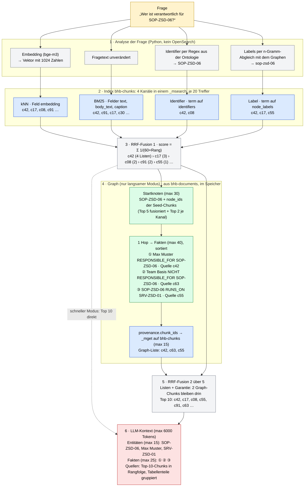

# Retrieval-Trichter: von der Frage zum LLM-Kontext

Beispiel an der Frage **„Wer ist verantwortlich für SOP-ZSD-06?“**. Die Chunk-Nummern (c42, c17 …) und Fakten sind
zur Veranschaulichung erfunden; Stufen, Felder, Indizes und Grenzen sind die echten (`retrieval/src/rag_retrieval/`).

Farben: blau = Anfrage an OpenSearch, grau = Python im Retriever, grün = Graph im Speicher, rot = Ergebnis.

## Die erfundenen Chunks

| Chunk | Inhalt (Beispiel) | Gefunden durch |
|---|---|---|
| c42 | Tabelle „Verantwortlichkeiten“, Zeile SOP-ZSD-06 | alle 4 Kanäle + Graph |
| c17 | Abschnitt „Rollen und Zuständigkeiten“ | kNN, BM25, Label |
| c08 | Änderungshistorie, nennt SOP-ZSD-06 | kNN, Identifier |
| c91 | Einleitung, allgemeine Verantwortung | kNN, BM25 |
| c55 | Serverliste mit SRV-ZSD-01 | Label, Graph |
| c63 | Abgrenzung „nicht zuständig“ | nur Graph |

## Die Fusion nachgerechnet

Rang je Liste → Beitrag `1/(60+Rang)`; Summe ist der Score.

| Chunk | kNN | BM25 | Identifier | Label | Fusion 1 | Graph-Liste | Fusion 2 |
|---|---|---|---|---|---|---|---|
| c42 | 1 → 0,0164 | 1 → 0,0164 | 1 → 0,0164 | 1 → 0,0164 | **0,0656** | 1 → 0,0164 | **0,0820** |
| c17 | 2 → 0,0161 | 3 → 0,0159 | – | 2 → 0,0161 | 0,0481 | – | 0,0481 |
| c08 | 3 → 0,0159 | – | 2 → 0,0161 | – | 0,0320 | – | 0,0320 |
| c91 | 4 → 0,0156 | 2 → 0,0161 | – | – | 0,0318 | – | 0,0318 |
| c55 | – | – | – | 3 → 0,0159 | 0,0159 | 3 → 0,0159 | 0,0317 |
| c63 | – | – | – | – | 0 | 2 → 0,0161 | 0,0161 |

Lesart: c42 gewinnt, weil es in jeder Liste vorne steht, nicht weil ein Kanal einen hohen Score hatte. Die Graph-Liste
hebt c55 an und bringt c63 überhaupt erst ins Spiel; läge c63 außerhalb der Top 10, würde die Garantie
(`graph_min_sources = 2`) es als zweiten Graph-Chunk trotzdem hineinnehmen.
